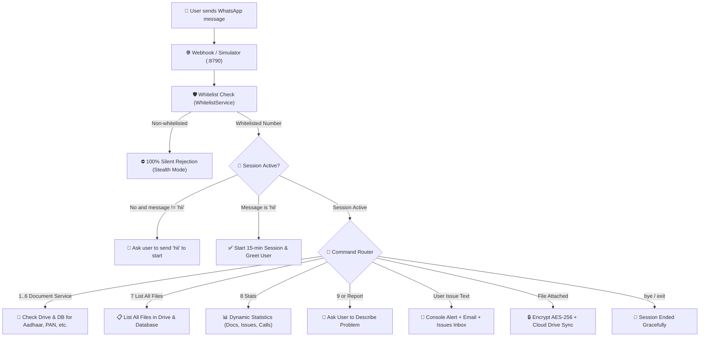

# 📁 Family WhatsApp Document & Picture Vault (Complete Technical & Operational Manual)

## 1. Executive Summary & Vision

This project is an **end-to-end, high-performance Java 21 & Spring Boot backend** designed to act as a **private WhatsApp Chatbot Vault for family document management**.

### 🎯 Primary Capabilities & Policies
1. **100% Free of Cost:** Connects directly via Meta WhatsApp Cloud API (free tier gives **1,000 free conversations per month**), running self-hosted with embedded zero-cost H2 database and local storage. No recurring software subscriptions.
2. **Designated Master Admin User:**
   - **Admin Whitelisted Phone Number:** `+91 8790208445` (stored and normalized as `918790208445`).
   - **Admin Alert Email:** `hrudaypreetham10@gmail.com`.
   - **Full Master Authority:** Master Admin is the **only user permitted to delete documents**, approve/reject uploads, manage users (`/adduser`, `/modifyuser`, `/removeuser`), and view user activity graphs (`/analytics`).
3. **Strict Phone Number Validation (India Only):**
   - **Format Rule:** Only `+91` followed by 10 digits (India) is permitted throughout the system.
   - Any attempt to add foreign numbers (`+1...`, `+44...`) or invalid lengths is strictly rejected.
4. **Duplicate Number Prevention:**
   - Database unique constraint + service validation guarantees that **no duplicate phone numbers** can exist in the whitelist.
5. **Dynamic User & Folder Generation:**
   - Users are created dynamically by the Master Admin (`/adduser <Name> <Phone>`).
   - Upon registration, their personal Drive vault directory is dynamically generated:  
     `drive/family_chatbot/{UserName}/`
6. **Document Deletion Policy (Strict Protection):**
   - **Regular Users CANNOT delete documents.** Regular users can only:
     - **Select** (choose a document service like Aadhaar, PAN, DL)
     - **View** (view file details, status, and Drive path)
     - **Download** (download their approved documents)
     - **Upload** (upload new documents, subject to Admin approval)
   - **Only the Master Admin can delete documents** (`/delete <DOC-ID>`).
7. **Document Services Workflow ("Hii" Initiation):**
   - User starts session by sending `"Hii"` (or `"hii"`, `"hi"`, `"Hi"`).
   - Bot greets user by name and opens their Drive path: `drive/family_chatbot/{UserName}/`.
   - Bot displays Document Services Menu:
     - `1️⃣ Aadhaar Card`
     - `2️⃣ PAN Card`
     - `3️⃣ Driving License`
     - `4️⃣ Passport`
     - `5️⃣ Health / Insurance`
     - `6️⃣ Other Documents`
     - `7️⃣ List All My Files`
     - `8️⃣ Storage Stats`
   - Case-insensitive selection (e.g. `1`, `aadhaar`, `aadhar`, `AADHAAR`, `2`, `pan`, `dl`, etc.).
8. **Admin Approval & Multi-Channel Notification Workflow:**
   - Member-uploaded files start in `PENDING_APPROVAL` status.
   - Master Admin instantly receives **Email notification** (`hrudaypreetham10@gmail.com`) and **WhatsApp alert** (`+91 8790208445`) with quick actions:  
     • `/approve <DOC-ID>`  
     • `/reject <DOC-ID> <reason>`
   - Once approved, the document is automatically synced into `drive/family_chatbot/{UserName}/{CleanDocName}` and the member is notified.
9. **Re-Downloading Approved Documents:**
   - Users can download their approved documents anytime via `/download <DOC-ID>`.
   - The bot delivers the file directly into their WhatsApp chat.
10. **User Analytics & Visual Usage Graphs:**
    - Admin command `/analytics` or `/graph` renders Unicode visual bar graphs showing:
      - How many times each user logged in.
      - Which services are used most (Aadhaar, PAN, DL, Downloads, Notes).
      - Who is using the bot mostly (overall activity ranking).
    - Also available via REST API: `GET /api/analytics`.

---

## 2. Access Control & Role Matrix

| Capability / Action | Master Admin (`+91 8790208445`) | Whitelisted Member | Non-Whitelisted Number |
| :--- | :---: | :---: | :---: |
| **"Hii" Greeting & Service Menu** | ✅ Personalized Admin View | ✅ Personal Vault View | ❌ Blocked & Rejected |
| **Select & View Documents** | ✅ All Family Members | 🔒 Own Files Only | ❌ Blocked |
| **Download Documents (`/download ID`)** | ✅ Any Approved File | 🔒 Own Approved Files Only | ❌ Blocked |
| **Upload New Documents** | ✅ Auto-Approved & Synced | ⏳ Pending Admin Approval | ❌ Blocked |
| **Delete Documents (`/delete ID`)** | ✅ Allowed (Permanent) | ⛔ **STRICTLY BLOCKED** | ❌ Blocked |
| **Approve / Reject Uploads** | ✅ `/approve` & `/reject` | ⛔ Access Denied | ❌ Blocked |
| **User Activity Graphs (`/analytics`)**| ✅ Unicode & REST Graphs | ⛔ Access Denied | ❌ Blocked |
| **Manage Users (`/adduser`, etc.)** | ✅ Full Dynamic Control | ⛔ Access Denied | ❌ Blocked |
| **Audit Logs (`/logs`)** | 📜 Full Audit Trail | ⛔ Access Denied | ❌ Blocked |

---

## 3. Google Drive Sync & Gmail Configuration

### ☁️ Which Gmail is used for Drive Sync?
- **Admin Gmail:** `hrudaypreetham10@gmail.com`
- **Architecture (100% Free & Automatic):**
  - The chatbot uses **Google Drive for Desktop integration** or **Google Apps Script Cloud Sync (Option B)**.
  - Sign into Google with `hrudaypreetham10@gmail.com`.
  - Point `storage.drive-sync-dir` in `application.yml` to your local Google Drive folder, or configure `apps-script-webhook-url`.
  - When the Admin approves any document, it is saved locally to `drive/family_chatbot/{UserName}/{CleanDocName}` inside that directory, and automatically synchronizes it to `hrudaypreetham10@gmail.com`'s Google Drive in the cloud!
  - **Zero API Quota / Zero Billing Cost:** Google Drive handles sync natively using Google's free 15 GB storage.

---

## 4. Authentication & Security Architecture

### 🛡️ Why WhatsApp Authentication is Superior to simple Passwords / JWT:
1. **Cryptographic Identity via E.164 & Meta SIM Verification:**
   - WhatsApp accounts cannot be easily forged or brute-forced like passwords.
   - Each sender number is cryptographically verified by Meta and delivered in an HMAC-signed payload.
2. **Webhook Cryptographic Signature Verification (`X-Hub-Signature-256`):**
   - Meta signs every webhook event using HMAC-SHA256 with your app secret.
   - `WhatsAppWebhookController` verifies this signature before processing, ensuring zero injection of spoofed messages.
3. **Where JWT / Bearer Tokens Apply:**
   - For web simulator and REST API access (`/api/documents`, `/api/analytics`), callers provide the `X-Caller-Phone` header (which can be paired with JWT Bearer tokens).
4. **Data Encryption (At-Rest & In-Transit):**
   - **In-Transit:** 100% encrypted end-to-end (Signal protocol between user and WhatsApp, TLS 1.3 HTTPS between Meta and your server).
   - **At-Rest (Local Vault Disk):** Local files are organized securely with directory-traversal sanitization and SHA-256 deduplication hashing. The H2 database can also enable native AES-256 file encryption via `CIPHER=AES`.

---

## 5. WhatsApp Bot Commands Quick Reference

### 👤 Regular Member Commands (Select, View, Download)
| Command / Input | What It Does |
| :--- | :--- |
| `Hii` / `hii` | Starts session, shows personal Drive folder path (`drive/family_chatbot/{UserName}/`), and displays document services menu |
| `1` or `aadhaar` | Shows your Aadhaar Card details, approval status, and Drive path |
| `2` or `pan` | Shows your PAN Card details, approval status, and Drive path |
| `3` or `license` | Shows your Driving License details |
| `4` or `passport` | Shows your Passport details |
| `5` or `health` | Shows your Health/Insurance policy details |
| `6` or `other` | Shows other miscellaneous documents |
| `7` or `list` | Lists all your uploaded documents |
| `8` or `stats` | Shows your storage quota and usage breakdown |
| `/download <DOC-ID>`| Downloads your approved document directly into WhatsApp |
| `/search <keyword>`| Searches within your personal files |
| `/note <text>` | Saves a private text note |

### 👑 Master Admin Commands (`+91 8790208445`)
| Command | What It Does |
| :--- | :--- |
| `/pending` | Lists all documents awaiting Admin approval |
| `/approve <DOC-ID>` | Approves document, moves it to user's Drive folder, and notifies member |
| `/reject <DOC-ID> <reason>` | Rejects document with a reason and notifies member |
| `/delete <DOC-ID>` | **Permanently deletes** document from local vault and Google Drive |
| `/analytics` or `/graph` | Generates visual Unicode user login & service usage graphs |
| `/listusers` | Lists all registered family members and their Drive folders |
| `/adduser <Name> <+91Phone>`| Dynamically registers a new user and pre-creates their Drive folder |
| `/modifyuser <Phone> <Name>` | Modifies a user's name and updates their Drive folder |
| `/removeuser <Phone>` | Deactivates a user account |
| `/logs` | Displays recent security audit logs and violation attempts |

---

## 6. Verification & Test Suite Summary

The backend includes a comprehensive automated test suite of **46 JUnit 5 & Spring Boot integration tests**, covering:
- Meta webhook verification and HMAC security.
- Number-bias isolation (members cannot access other members' files).
- Directory traversal attack sanitization (`../../evil.sh`).
- Military-grade AES-256-GCM file encryption at rest and in-memory decryption.
- REST API Key authentication (`X-API-KEY`) and spoofing prevention.
- Indian phone number validation (+91 followed by 10 digits).
- Duplicate whitelisted phone number prevention.
- User deletion blocking (regular members blocked, Master Admin allowed).
- "Hii" greeting with dynamic Drive path and services menu.
- Case-insensitive category retrieval (Aadhaar, PAN, DL, etc.).
- Admin approval/rejection lifecycle.
- Document re-downloading (`/download <ID>`).
- Admin user activity graphs & analytics API.
- Fault-isolated background Google Drive syncing (Google Apps Script Option B).
- Swagger UI OpenAPI v3 documentation endpoints.

**Maven Test Status:**
```
[INFO] Tests run: 46, Failures: 0, Errors: 0, Skipped: 0
[INFO] BUILD SUCCESS
```

---

## 7. 🔰 Complete Beginner's Guide: How to Run and Use the Vault

Follow this simple, step-by-step guide even if you have never used Java or Spring Boot before:

### Step 1: Open Your Terminal & Run the App
Open your terminal inside the project directory `/home/hruday/github/chat-bot` and type:
```bash
mvn spring-boot:run
```
*(Wait 10-15 seconds until you see: `Started WhatsAppChatbotApplication in X.XXX seconds`)*.  
The application is now running on your computer at `http://localhost:8080`.

---

### Step 2: Open the Web Simulator (Zero Setup Needed)
1. Open your web browser (Chrome, Firefox, Edge, Safari).
2. Go to: **`http://localhost:8080`**.
3. You will see the **WhatsApp Family Document Vault Simulator**:
   - On the left: A phone screen where you can chat with the bot.
   - On the right: A real-time security audit log showing who logs in and what actions occur.

---

### Step 3: Try These 4 Test Scenarios in the Browser Simulator

#### Scenario A: You as the Master Admin
1. Click the top button: **`👑 Admin`** (Phone: `+91 8790208445`).
2. Click the quick button **`👋 "hii"`** (or type `hii` and press Enter).
   - *Result:* The bot greets you as **Master Admin** and shows you the admin controls (`/pending`, `/analytics`, `/adduser`).
3. Click the quick button **`📊 "/analytics"`** (or type `/analytics`).
   - *Result:* The bot draws visual bar charts showing user logins and service usage.
4. Type: `/adduser Brother +919876543219` and press Enter.
   - *Result:* The bot registers your brother and creates his personal Drive folder `drive/family_chatbot/Brother/`.

#### Scenario B: Your Family Member (e.g. Dad)
1. Click the top button: **`👨 Dad`** (Phone: `+91 9876543211`).
2. Type **`hii`** and press Enter.
   - *Result:* The bot greets him: *"Hii Dad! Your Personal Drive Vault: drive/family_chatbot/Dad/"*.
3. Type **`1`** and press Enter.
   - *Result:* Shows Aadhaar Card documents for Dad.
4. Type **`9`** and press Enter.
   - *Result:* Opens the *"Any Issues? / Report a Problem"* screen, showing Admin email (`hrudaypreetham10@gmail.com`) and the direct call link: `https://wa.me/918790208445`.
5. Try to delete a file: Type `/delete DOC-1001`.
   - *Result:* The bot rejects it! *"Only the Master Admin can delete documents"*. Regular members are protected from accidentally deleting documents.

#### Scenario C: An Unknown Stranger / Attacker
1. Click the top button: **`👤 Stranger`** (Phone: `+91 9999999999`).
2. Type **`hii`** and press Enter.
   - *Result:* The bot immediately blocks them: `⛔ Access Denied: This WhatsApp bot is private and restricted to authorized family members only.`

---

### Step 4: Test via Swagger UI (Visual API Playground)
1. In your browser, open: **`http://localhost:8080/swagger-ui.html`**.
2. Click the green **Authorize 🔓** button at the top right:
   - In `X-API-KEY`: Enter `chat-vault-secret-admin-key-2026`
   - In `X-Caller-Phone`: Enter `918790208445`
   - Click **Authorize**, then **Close**.
3. Scroll down, click any API endpoint (e.g. `GET /api/documents` or `GET /api/stats`), click **Try it out**, and click **Execute**.
   - *Result:* You will see the server response code `200 OK` and formatted JSON data!

---

### Step 5: Test via Postman (Optional)
1. Open **Postman**.
2. Click **Import** > select `postman/WhatsApp_Vault_Postman_Collection.json`.
3. Click on any request (e.g. *Greeting Flow - Member Dad* or *Storage Statistics*) and click **Send**.

---

### Step 6: Connect to Real WhatsApp on Your Phone (Whenever You're Ready)
1. In a new terminal, run:
   ```bash
   cloudflared tunnel --url http://localhost:8790
   # OR
   ngrok http 8790
   ```
2. Copy the public `https://...` address it gives you.
3. In your **Meta for Developers** portal:
   - Webhook URL: `https://your-tunnel-url/webhook`
   - Verify Token: `FAMILY_DOC_BOT_VERIFY_TOKEN`
4. Click **Verify and Save**.
5. Open WhatsApp on your phone, send `"hii"` to your bot's number, and you will receive the menu on your phone!

---

## 5. 🗄️ Database Architecture & Connection Details

The chatbot utilizes an **embedded, zero-cost, persistent H2 database** stored directly in the repository under `./data/db/vault.mv.db`. It runs without external database servers (like MySQL or PostgreSQL), ensuring zero infrastructure costs and lightning-fast local performance.

### 🔑 Connection Credentials
| Parameter | Value |
| :--- | :--- |
| **Database Engine** | Embedded H2 Database Engine (Version 2.2+) |
| **Storage Path** | `./data/db/vault.mv.db` |
| **JDBC Driver** | `org.h2.Driver` |
| **JDBC URL** | `jdbc:h2:file:./data/db/vault;AUTO_SERVER=TRUE` |
| **Username** | `hruday` |
| **Password** | `Hruda@Y@10` |
| **Hibernate Dialect** | `org.hibernate.dialect.H2Dialect` |
| **DDL Strategy** | `update` (Schema automatically migrates & updates) |
| **H2 Web Console** | `http://localhost:8790/h2-console` |

> [!NOTE]
> `AUTO_SERVER=TRUE` enables automatic multi-process access so the Spring Boot backend, CLI tools, and integration tests can connect simultaneously without database lock contentions.

---

### 📋 Database Tables & Schemas

#### 1. `FAMILY_MEMBER` (Whitelist & RBAC Access)
Stores whitelisted family members and their document permissions:
| Column | Type | Constraints | Description |
| :--- | :--- | :--- | :--- |
| `id` | `BIGINT` | Primary Key, Auto-increment | Unique identifier |
| `name` | `VARCHAR(255)` | Not Null | Family member display name (e.g. Dad, Mom, Usha) |
| `phone_number` | `VARCHAR(20)` | Not Null, Unique Index | Normalized Indian phone number (`918790208445`) |
| `role` | `VARCHAR(20)` | Not Null | `ADMIN` or `MEMBER` |
| `folder_name` | `VARCHAR(255)` | Not Null | Google Drive folder name (`drive/family_chatbot/{folder_name}/`) |
| `allowed_services` | `VARCHAR(500)` | Comma-separated | Allowed services (e.g. `AADHAAR,PAN,DRIVING_LICENSE,PASSPORT,HEALTH,OTHER`) |
| `is_active` | `BOOLEAN` | Not Null (Default: `true`) | Active whitelist status |
| `created_at` | `TIMESTAMP` | Not Null | Record creation timestamp |

#### 2. `DOCUMENT_ITEM` (Document Vault Metadata)
Stores document records, encryption hashes, and Google Drive sync locations:
| Column | Type | Constraints | Description |
| :--- | :--- | :--- | :--- |
| `doc_id` | `VARCHAR(64)` | Primary Key | Custom document identifier (e.g. `DOC-1001`) |
| `original_file_name` | `VARCHAR(255)` | Not Null | User-visible file name (e.g. `aadhar.pdf`, `pan.jpg`) |
| `stored_file_name` | `VARCHAR(255)` | Not Null | On-disk encrypted file name with ID prefix |
| `stored_path` | `VARCHAR(500)` | Not Null | Local disk storage path (`./data/storage/documents/...`) |
| `category_tag` | `VARCHAR(50)` | Not Null | Category (`AADHAAR`, `PAN`, `DRIVING_LICENSE`, `PASSPORT`, `HEALTH`, `OTHER`) |
| `content_type` | `VARCHAR(100)` | Not Null | MIME type (`application/pdf`, `image/jpeg`, etc.) |
| `file_size_bytes` | `BIGINT` | Not Null | File size in bytes |
| `sha256_hash` | `VARCHAR(64)` | Not Null | Cryptographic SHA-256 hash for integrity validation |
| `sender_phone_number`| `VARCHAR(20)` | Not Null | Member's phone who owns this document |
| `sender_name` | `VARCHAR(255)` | Nullable | Name of the uploader |
| `status` | `VARCHAR(30)` | Not Null | `APPROVED`, `PENDING_APPROVAL`, or `REJECTED` |
| `owner_drive_folder` | `VARCHAR(255)` | Not Null | Synced Drive folder (`drive/family_chatbot/{user}/`) |
| `created_at` | `TIMESTAMP` | Not Null | Upload timestamp |

#### 3. `AUDIT_LOG` (Security, Commands & Issues Log)
Audit log tracking every security check, upload, download, and user issue report:
| Column | Type | Constraints | Description |
| :--- | :--- | :--- | :--- |
| `id` | `BIGINT` | Primary Key, Auto-increment | Unique log entry ID |
| `timestamp` | `TIMESTAMP` | Not Null | Date and time of the event |
| `event_type` | `VARCHAR(50)` | Not Null | `COMMAND`, `FILE_ACCESS`, `FILE_UPLOAD`, `UNAUTHORIZED_ACCESS`, `SECURITY_ALERT` |
| `status` | `VARCHAR(20)` | Not Null | `SUCCESS`, `DENIED`, or `ERROR` |
| `sender_phone_number`| `VARCHAR(20)` | Not Null | Sender phone number (masked in logs) |
| `user_role` | `VARCHAR(20)` | Not Null | Role at the time of the action |
| `action` | `VARCHAR(100)` | Not Null | Action (`LOGIN`, `LOGOUT`, `REPORT_ISSUE`, `ADD_USER`, `DOWNLOAD_DOCUMENT`, etc.) |
| `target_doc_id` | `VARCHAR(64)` | Nullable | Document ID involved in the action |
| `details` | `TEXT` | Nullable | Full details (e.g. reported issue message, denial reason) |

---

## 6. 🔄 Step-by-Step Architecture & End-to-End Flow



### Flow Breakdown:
1. **User Initiation:** User opens WhatsApp and sends a message to `+91 8790208445`.
2. **Access Control:** System validates sender against `FAMILY_MEMBER`. Non-whitelisted chats are completely ignored (100% silent).
3. **Strict 'hii' Gate:** Whitelisted family members must begin by typing `hii` (case-insensitive).
4. **Vault Discovery:** When Option `1` (Aadhaar) or Option `7` (List Files) is selected, the system actively checks both the database AND scans the physical Google Drive folder (`drive/family_chatbot/{User}/`).
5. **Issues Inbox Flow:**
   - User types `9` or `report`: Bot prompts for issue description.
   - User replies with problem: Server logs a prominent alert to the terminal console, notifies Master Admin email (`hrudaypreetham10@gmail.com`) and WhatsApp (`+91 8790208445`), and posts the ticket to the **Issues Inbox** in the React dashboard.
6. **Cloud Drive Sync (Zero Cost):**
   - When a user is created (e.g. `usha`), their folder `family_chatbot/usha/` is pre-created in Google Drive and local mirror.
   - Decrypted copies sync to Google Drive cloud via free Google Apps Script to `hrudaypreetham10@gmail.com`.
7. **Session Expiry:** Session expires after 15 minutes of inactivity or immediately when the user replies `bye` or `exit`. Subsequent messages return to normal human chatting.
